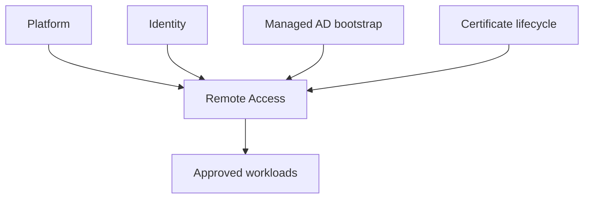

# ADR-006: Separate Remote Access lifecycle stack

## Status

Proposed — pending organizational review.

Remote Access is an independent Terraform lifecycle stack. Existing deployed
environments that previously owned Client VPN resources in another Terraform
state require an explicit state-ownership migration before adoption.

## Context

Platform creates VPCs, subnets, routing, Transit Gateway integration, and
shared workload security groups.

Identity creates AWS Managed Microsoft AD and directory DNS services.

AWS Client VPN has different dependencies depending on the selected
authentication mode:

- `directory` requires Platform and Identity;
- `mutual` requires Platform but does not require Identity;
- `directory_and_mutual` requires Platform and Identity.

Keeping Client VPN inside Platform would couple networking lifecycle to
authentication resources and would introduce a reverse dependency on Identity
for directory-based modes.

Client VPN also applies IPv4 source NAT. A target workload does not see the
Client VPN client-pool address. It sees the private address of a Client VPN
network interface in an associated subnet.

Security-group policy based on the client address pool therefore does not
represent the traffic source seen by target workloads.

## Decision

AWS Client VPN is owned by an independent `remote-access` lifecycle stack.



Platform is always required.

Identity and Managed AD bootstrap are required only for authentication modes
that use directory authentication.

## Remote Access ownership

Remote Access owns:

- the Client VPN endpoint;
- target-network associations;
- Client VPN authorization rules;
- explicit Client VPN routes;
- the dedicated endpoint security group;
- additive ingress rules on approved Platform-owned security groups; and
- Client VPN connection logging resources.

Platform continues to own:

- VPCs;
- subnets;
- route tables;
- Transit Gateway integration;
- shared workload security groups; and
- the broader IRE network topology.

Identity continues to own:

- AWS Managed Microsoft AD;
- directory DNS information; and
- directory-service-specific security policy.

Persistent owns:

- the KMS key protecting persistent Client VPN PKI state; and
- the private versioned S3 bucket used for EasyRSA PKI persistence.

## Certificate lifecycle boundary

Remote Access Terraform does not create certificates or private keys.

Certificate lifecycle operations are performed through dedicated AAP
automation.

For the EasyRSA implementation, AAP:

1. reads the Persistent PKI storage contract;
2. restores existing EasyRSA PKI into a temporary execution workspace;
3. creates the CA only when explicitly authorized for first-time bootstrap;
4. generates the Client VPN server certificate;
5. imports the server certificate, private key, and CA chain into ACM;
6. removes the generated server private key before the PKI archive is
   persisted;
7. writes the updated PKI state back to KMS-encrypted S3; and
8. publishes the certificate ARN for downstream Remote Access execution.

The current EasyRSA workflow publishes the imported ACM certificate ARN as both
`server_certificate_arn` and `client_root_certificate_chain_arn` for mutual
authentication modes.

That is an implementation-specific binding and is not a generic requirement of
the reusable Client VPN Terraform module.

## Client certificate boundary

Client certificate issuance uses the existing EasyRSA certificate authority.

The client private key must remain on the client endpoint.

AAP receives only a certificate signing request.

AAP:

1. validates the supplied CSR;
2. restores the existing EasyRSA PKI;
3. requires the existing CA;
4. imports and signs the CSR;
5. persists the updated EasyRSA certificate database; and
6. publishes the signed client certificate and CA certificate through the
   protected certificate artifact path.

Client certificate issuance cannot create a new CA.

## Authentication modes

### Directory

`directory` requires:

- Platform;
- Identity;
- Managed AD authorization-group bootstrap;
- an ACM server certificate.

Clients authenticate using Managed AD credentials.

A client certificate is not required.

### Mutual

`mutual` requires:

- Platform;
- an ACM server certificate;
- the approved client root certificate-chain ARN; and
- a client certificate and endpoint-local private key.

Managed AD is not required.

The Remote Access stack maps `mutual` to the reusable Client VPN module's
`certificate` authentication mode.

### Directory and mutual

`directory_and_mutual` requires:

- Platform;
- Identity;
- Managed AD authorization-group bootstrap;
- an ACM server certificate;
- the approved client root certificate-chain ARN; and
- a valid client certificate/private-key pair.

Both directory credentials and certificate authentication must succeed.

## Network-source policy

Target ingress uses the selected Client VPN association-subnet CIDRs from the
Platform contract.

It does not use the Client VPN client CIDR as the workload-visible source.

The Client VPN endpoint does not create an unrestricted path into Protected
Data. Routing, authorization, Transit Gateway policy, Network Firewall policy,
and workload security groups remain separate enforcement layers.

## Lifecycle order

The required creation order depends on authentication mode.

### Directory

```text
Platform
  -> Identity
  -> Managed AD bootstrap
  -> Server certificate
  -> Remote Access
```

### Mutual

```text
Persistent PKI
  -> Platform
  -> Server certificate
  -> Remote Access
  -> Client certificate issuance
```

### Directory and mutual

```text
Persistent PKI
  -> Platform
  -> Identity
  -> Managed AD bootstrap
  -> Server certificate
  -> Remote Access
  -> Client certificate issuance
```

Remote Access must be destroyed before dependencies that it consumes are
removed.

Persistent PKI is long-lived and is not part of normal Remote Access teardown.

## Existing-state migration

Changing Client VPN ownership between Terraform stacks is a state migration,
not a destroy-and-recreate operation.

Before adopting Remote Access in an environment where Client VPN resources are
already owned by another Terraform state:

1. inventory the exact existing resource addresses;
2. preserve protected state snapshots;
3. transfer ownership using reviewed Terraform state migration procedures;
4. plan both the source and destination stacks; and
5. prove that neither plan contains unintended destruction or replacement.

Do not remove Client VPN resources from an existing owner stack and apply that
change before ownership has been transferred.

## Consequences

This decision:

- removes the Identity reverse dependency from Platform;
- permits mutual-only Client VPN deployments without Managed AD;
- keeps Remote Access lifecycle independent from foundational networking;
- preserves explicit PKI lifecycle ownership;
- allows directory and certificate authentication to evolve independently;
- requires contract brokering through AAP; and
- requires controlled state migration for previously deployed Client VPN
  resources.
