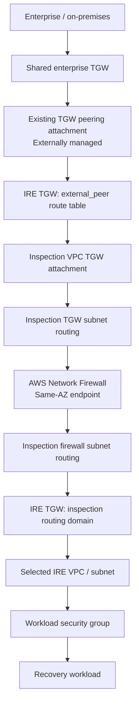
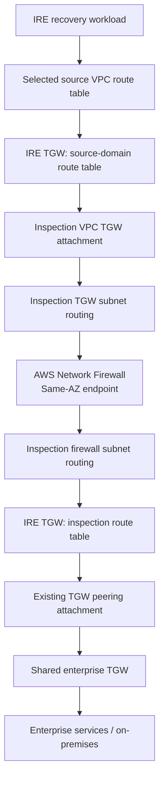
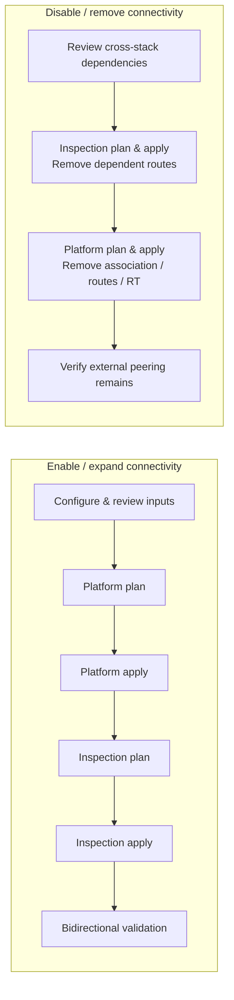

# Transit Gateway — External Peering and Inspected Enterprise Connectivity

## Purpose and scope

The IRE connects to an existing enterprise Transit Gateway (TGW) through an **externally managed TGW peering attachment**. IRE is the **requester** of the established attachment, and the enterprise/shared TGW is the **accepter** in the validated integration. The implementation consumes an existing attachment ID; Terraform **does not create, accept, import, or delete** that attachment.

The design keeps inbound and outbound enterprise traffic on a **centralized AWS Network Firewall inspection path**. Connectivity selection is configuration-driven; no fixed VPC, subnet, or route-table count is assumed.

## Architecture

### Inbound: enterprise to IRE



The dedicated `external_peer` TGW route table is the ingress routing boundary. Its selected destination routes point to the **Inspection VPC attachment**, not directly to recovery VPC attachments.

### Outbound: IRE to enterprise



These diagrams describe the **intended logical routing**. Route priority, same-AZ endpoint selection, security policy, symmetric return paths, and application recovery must also be validated at runtime. A successful connection on one protocol does not validate all services.

## Terraform ownership

| Ownership | Responsibilities |
|---|---|
| External networking | Shared TGW; peering creation and acceptance; external-side routing and connectivity |
| **Platform** | IRE TGW and VPC attachments; dedicated `external_peer` TGW route table; requester-side attachment association; selected VPC routes; normalized Inspection contract |
| **Inspection** | AWS Network Firewall; inspection-dependent TGW and VPC routes; external firewall IP set and policy integration |

The existing TGW peering attachment is a **dependency**, not a Terraform-managed resource. Removal of Platform-owned route tables, associations, or routes must **never** imply deletion of the peering attachment.

## Configuration contract

The `network_config.transit_gateway_peering` object is managed through environment-specific Platform configuration.

```hcl
transit_gateway_peering = {
  enabled       = false
  attachment_id = null
  remote_cidrs  = []

  external_to_ire = {
    core_recovery = {
      subnet_groups = ["recovery-services"]
    }
  }

  ire_to_external = {
    core_recovery = {
      route_table_groups = ["recovery-services"]
    }
  }
}
```

This is a **disabled, customer-neutral example**, not a ready-to-apply enterprise configuration. When enabled, the integration requires an existing valid `tgw-attach-*` ID and at least one valid remote IPv4 CIDR. The attachment ID and enterprise networks belong in environment-specific configuration rather than reusable source code.

**`external_to_ire`** selects the **destination subnet groups** reachable from the external network. Platform resolves those groups into actual subnet CIDRs. Inspection uses those CIDRs to add routes in the `external_peer` TGW route table targeting the Inspection VPC attachment.

**`ire_to_external`** selects the **source VPC route-table groups** that receive routes toward `remote_cidrs`. Platform adds the VPC routes to the IRE TGW; Inspection adds corresponding source-domain TGW routes toward the Inspection VPC attachment.

A **subnet group** determines *where the destination workloads live*. A **route-table group** determines *which source subnets receive an outbound route*. Routing does not replace firewall or security-group authorization.

## Stack sequencing and lifecycle



For additions, Platform publishes the TGW route-table and VPC contract first, then Inspection creates firewall-dependent routes. **For removal, the order reverses:** remove Inspection-owned dependent routes before deleting supporting Platform-owned integration resources. Because state is split across stacks, do not assume that setting `enabled = false` and applying Platform first is safe. Review the relevant plans and contracts before disabling.

Normal routing changes should be incremental; unexpected VPC, TGW, attachment, or subnet replacement is a **stop-and-review** condition. Do not run destructive lifecycle tests in a shared environment merely to demonstrate feature completeness.

## Security model

The following controls are distinct and all matter:

1. **VPC and TGW routing** establishes potential reachability.
2. **AWS Network Firewall** inspects and enforces the IRE network policy.
3. **Workload security groups** enforce instance-level permissions.
4. **Enterprise-side routing and firewall controls** enforce shared-network access.

During recovery-platform and backup-service connectivity validation, temporary broad remote CIDRs or permissive security rules may be intentionally used. These are **test settings, not a production security baseline**. Keep such settings under change control; narrow them after application and Commvault connectivity requirements have been established and approved.

## Validation checklist

- [ ] Confirm the existing peering attachment is **Available**, that IRE is requester, and that it is **not managed in this Terraform state**.
- [ ] Confirm the `external_peer` TGW route table and peering attachment association are correct.
- [ ] Confirm inbound selected destination CIDRs route via the Inspection VPC, not directly to workload attachments.
- [ ] Confirm selected outbound VPC route-table groups and source-domain TGW routes reach Inspection.
- [ ] Confirm Inspection subnet routes use the correct same-AZ Network Firewall endpoint and return to TGW.
- [ ] Validate firewall policy, security groups, external-side policy, and return routing.
- [ ] Validate selected and unselected subnet groups independently, including multi-AZ connectivity.
- [ ] Validate application-specific ports, DNS dependencies, and recovery workflows separately.
- [ ] Confirm plans do not replace foundational VPC/TGW resources or attempt to manage the external peering attachment.
- [ ] Document actual runtime test evidence and approved post-validation hardening.

## Troubleshooting boundaries

Successful IP/TCP connectivity through the inspected route establishes reachability for **that path and port**. Hostname resolution is a separate concern: enterprise DNS forwarding (for example, conditional forwarding through Route 53 Resolver) should be designed and operated under the appropriate DNS/Identity scope, not added implicitly to this peering feature.

For each connectivity failure, inspect in order: source VPC route table → source-domain TGW route table → Inspection VPC subnet route tables → Network Firewall logs and policy → Inspection TGW route table → peering/shared network → destination controls → return path.
